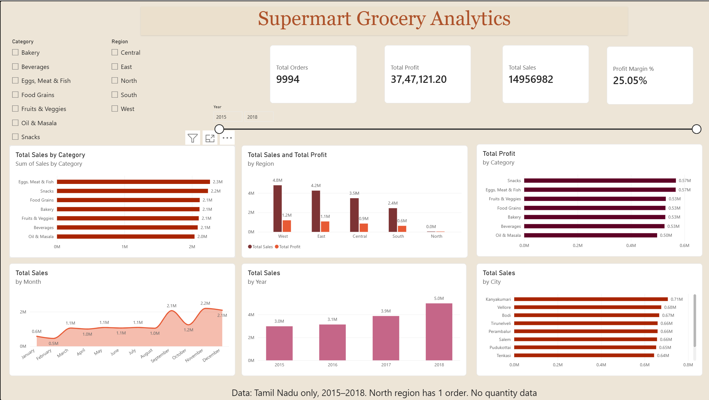

# Supermart Grocery Analytics

Retail sales analysis of 9,994 grocery orders (Tamil Nadu, Jan 2015 to Dec 2018) using Python, MySQL and Power BI.

## Dataset
Kaggle: Supermart Grocery Sales - Retail Analytics Dataset
https://www.kaggle.com/datasets/mohamedharris/supermart-grocery-sales-retail-analytics-dataset

## Tools
Python (pandas, numpy, matplotlib, seaborn), Jupyter Notebook, MySQL, Power BI

## Workflow
1. Data cleaning: checked missing values, duplicates, data types and outliers; converted Order Date to datetime; kept valid records, including 43 high-profit outliers
2. Exploratory data analysis: category, sub category, yearly and monthly trends, regions, discount vs profit
3. SQL analysis: 8 business queries, cross-checked against the Python results
4. Power BI dashboard: KPIs, category, region, city and time charts with slicers
5. Generative AI insights: coming soon

## Key findings
- Total sales 14,956,982; total profit 3,747,121; profit margin 25.05%
- Sales grew every year, from about 2.98M in 2015 to about 4.98M in 2018
- November, December and September are the strongest months
- West is the largest region by sales; Health Drinks and Soft Drinks are the top sub categories
- In this dataset, discount level shows no relationship with profit (correlation 0.000)

## Limitations
- Only Tamil Nadu, so no state comparison
- The North region has a single order, so it is not representative
- No quantity column, so units sold cannot be analysed
- No cost data, so reasons behind the patterns cannot be proven

## Repository structure
- data/ cleaned dataset
- notebooks/ Python cleaning and EDA
- sql/ MySQL queries
- dashboard/ Power BI file
- images/ dashboard screenshot
